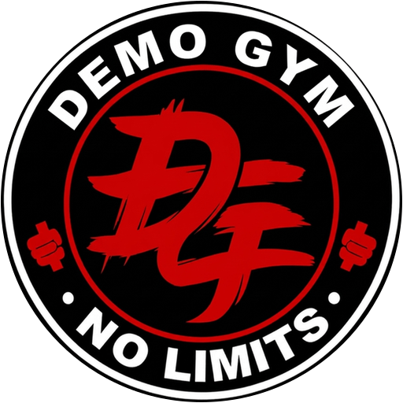

# Demo Gym

App web instalable (PWA) para gimnasios: los alumnos siguen su rutina, registran cada serie y ganan experiencia; los profesores administran alumnos, rutinas, asistencia y cuotas desde el celular o la PC.

> Presentación de un proyecto real, en uso en un gimnasio. La marca, las personas y los datos que se ven son inventados. Este repositorio no incluye el código: está en uno privado y puedo mostrarlo a pedido.

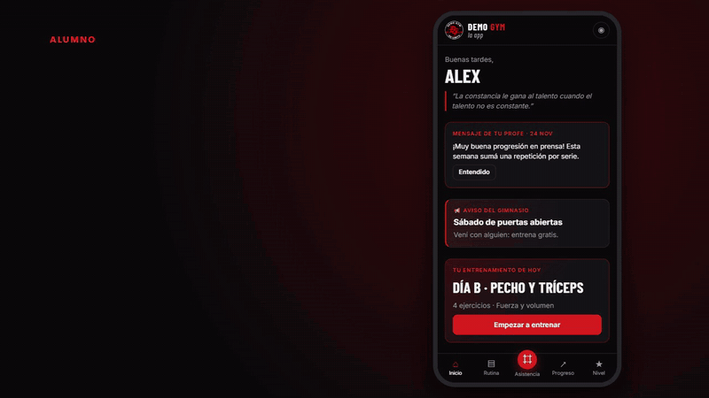

[Ver el video en mejor calidad](docs/demo.mp4)

## Capturas

**Alumno (celular)**

  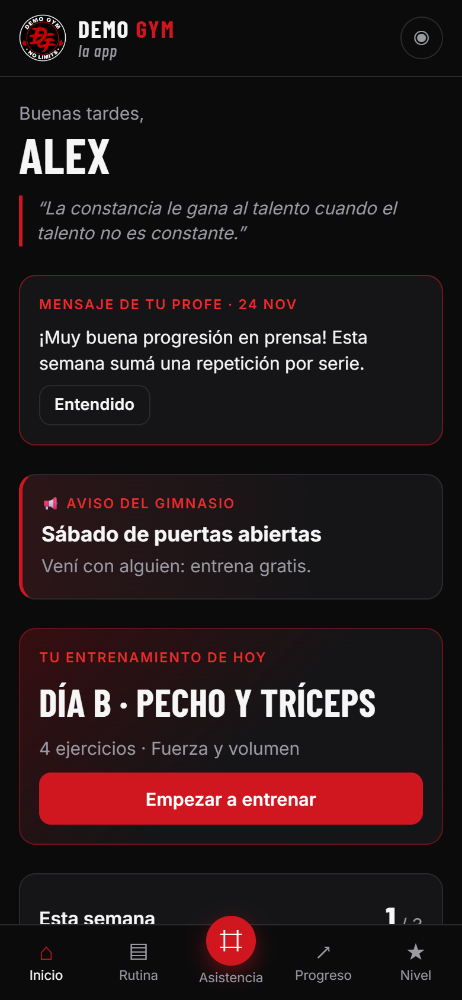
  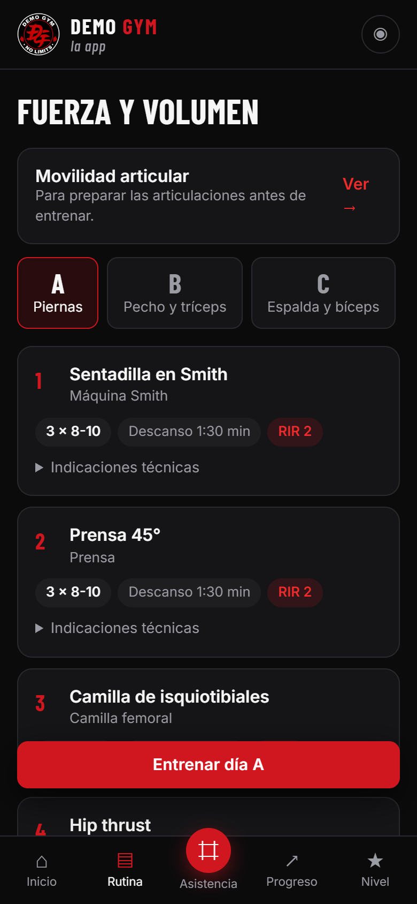
  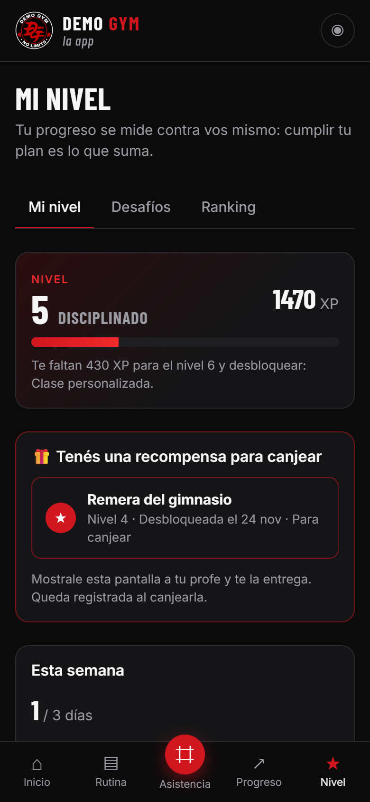
  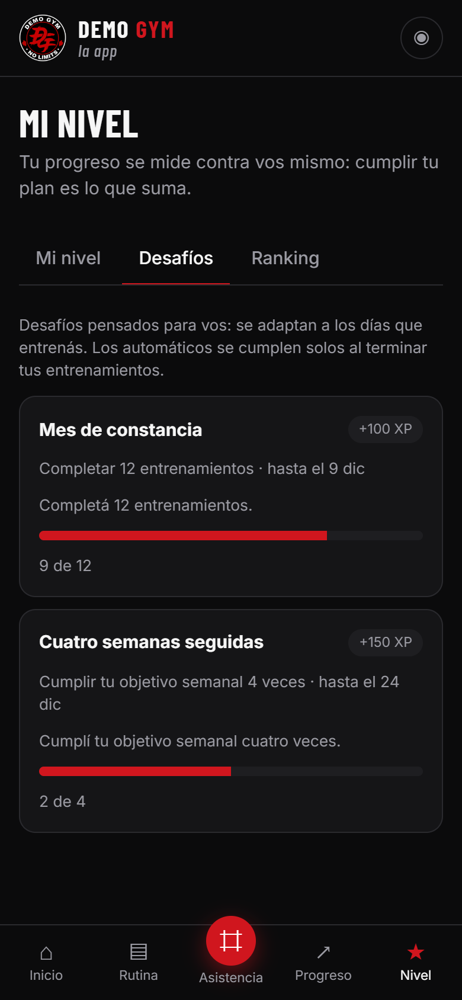
  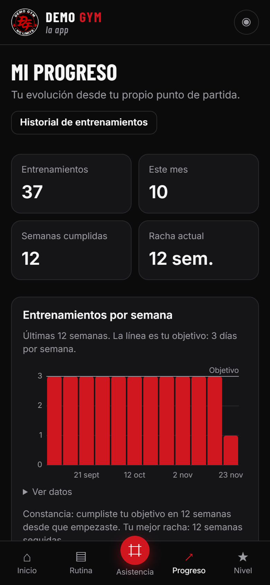
  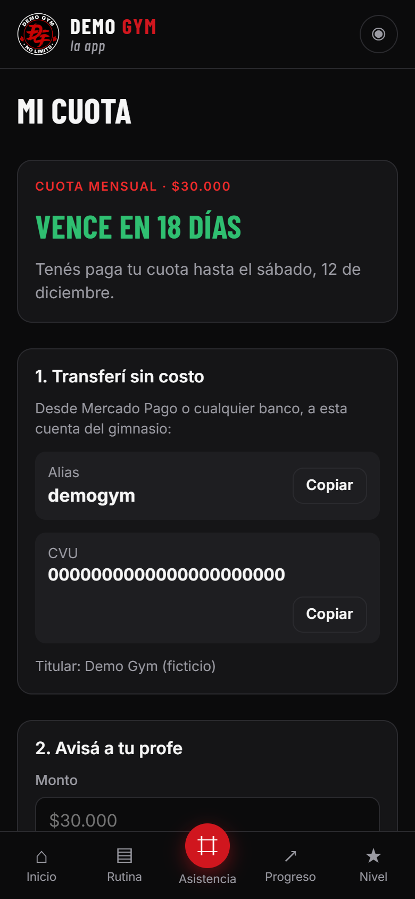

**Profes y recepción (PC)**

  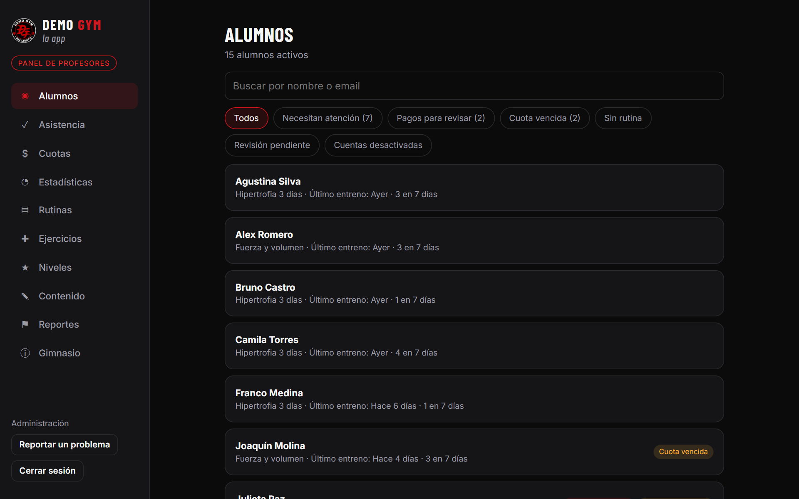
  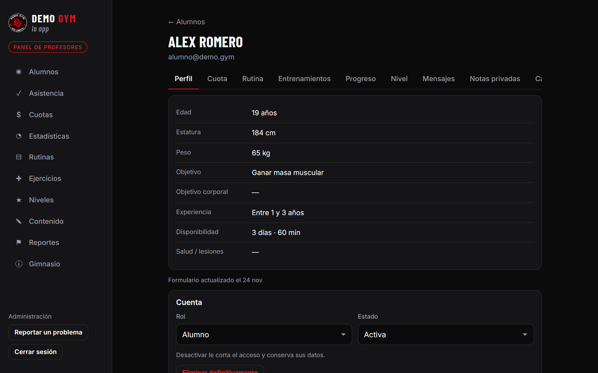
  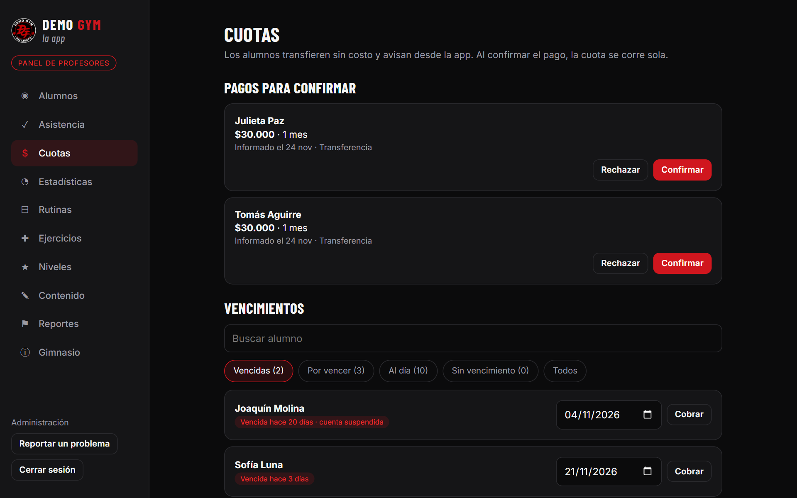
  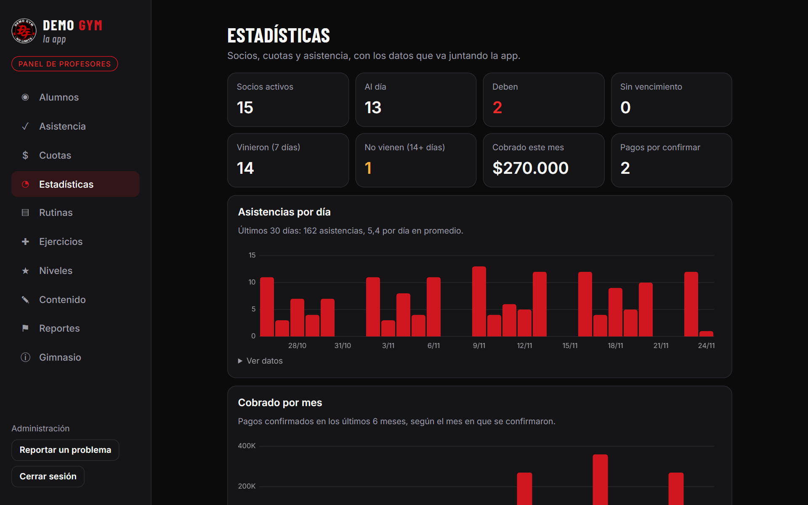
  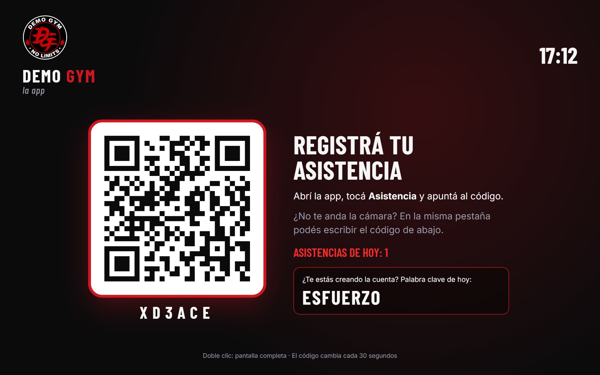

## Qué hace

**Alumnos**
- Rutina del día y registro de cada serie (peso, repeticiones, "última vez") con temporizador de descanso.
- Experiencia, niveles, recompensas, desafíos y ranking por grupos. La XP premia la constancia, no el peso levantado.
- Progreso: evolución por ejercicio, marcas personales y hábitos.
- Asistencia con un QR que rota cada 30 segundos en la pantalla de recepción.
- Pago de la cuota con comprobante y recordatorios push.

**Profesores y administradores**
- Alumnos, formularios de ingreso, notas privadas y alertas (sin rutina, sin entrenar, revisión pendiente).
- Biblioteca de ejercicios y plantillas de rutina que se copian al asignarlas.
- Cuotas, asistencia, mensajes, avisos, estadísticas y registro automático de errores.

## Tecnologías

| Parte | Tecnología |
|---|---|
| Interfaz | React 18, TypeScript, Vite, CSS propio |
| PWA | Service worker con Workbox y actualización automática |
| Datos y cuentas | Supabase: PostgreSQL y Auth |
| Notificaciones | Web Push desde una Edge Function (Deno), con `pg_cron` y `pg_net` |
| Pruebas | 62 pruebas de permisos y reglas sobre PGlite, sin internet |

## Decisiones técnicas

- **La seguridad está en la base.** Cada tabla tiene Row Level Security: manipular la app no da acceso a datos ajenos.
- **Las reglas también.** XP, un entrenamiento por día, suspensión por cuota vencida y alta de cuentas se resuelven con funciones y triggers de PostgreSQL.
- **Altas controladas.** Registrarse requiere una palabra clave diaria, y la cuenta se activa escaneando el QR del gimnasio.
- **Base versionada.** 34 migraciones numeradas; las pruebas las ejecutan desde cero en cada corrida.
- **Sin servidor propio.** Sitio estático más Supabase.

## Derechos

Todos los derechos reservados. Las imágenes y el video se publican como muestra de portfolio.
